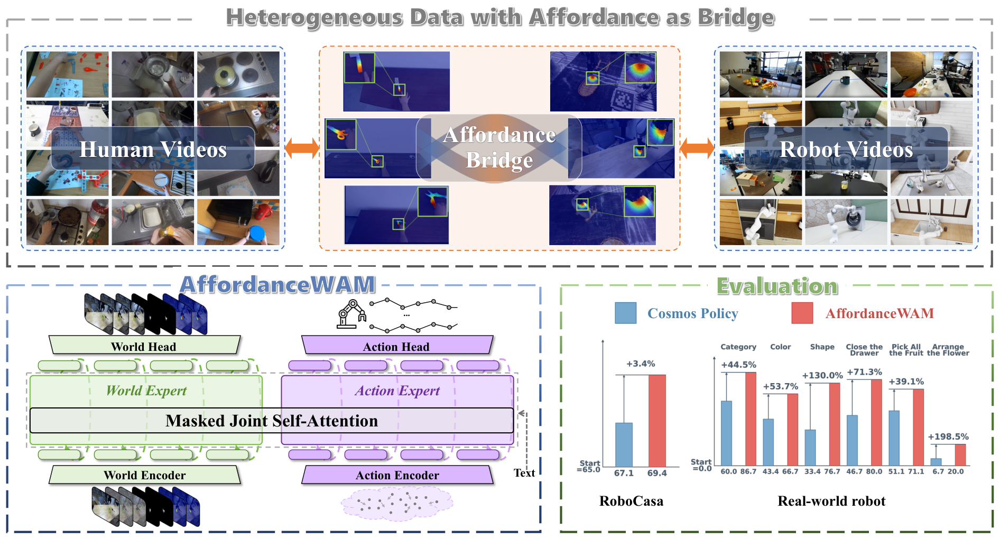
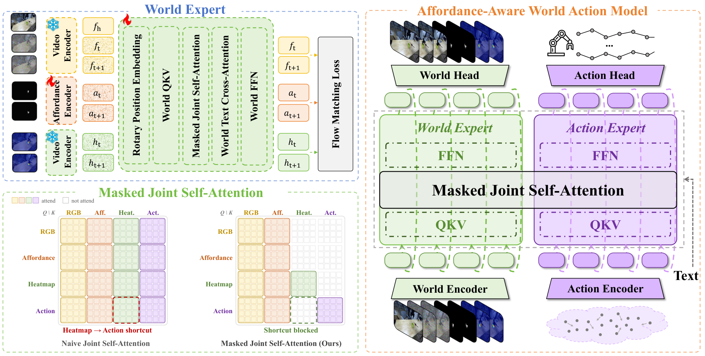
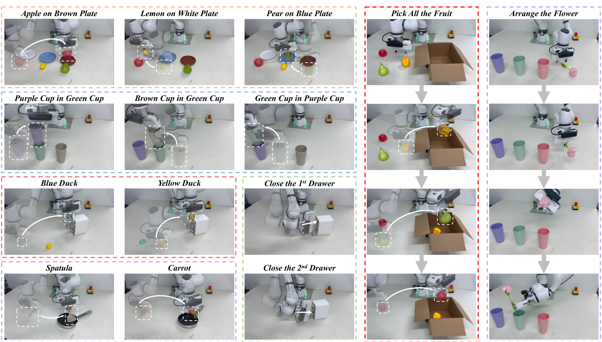

<div align="center">

## AffordanceWAM: Affordance-Aware Joint World–Action Modeling for Robot Manipulation

[](https://skywalker-yqz.github.io/AffordanceWAM/) [](https://arxiv.org/abs/2609.22332) [](LICENSE)

[Jiadi You](https://scholar.google.com/citations?hl=en&user=G5RR8WEAAAAJ)<sup>1,3,†</sup>, [Qize Yu](https://skywalker-yqz.github.io/)<sup>2,†</sup>, [Yue Chen](https://yuechen0614.github.io/)<sup>2</sup>, [Minghong Cai](https://onevfall.github.io/personal_page/)<sup>4</sup>, [Zhide Zhong](https://scholar.google.com/citations?user=msy4tL4AAAAJ)<sup>3</sup>, [Yuran Wang](https://wayrise.github.io/)<sup>5</sup>, [Bowen Ping](https://scholar.google.com/citations?hl=zh-CN&user=DjcKZdkAAAAJ)<sup>2</sup>, [Jiaqi Liang](https://screatorx.github.io/SCreatorX/)<sup>2</sup>, [Zhenhao Shen](https://github.com/stubborn111)<sup>2</sup>, [Haodong Yan](https://haodong-yan.github.io/)<sup>3</sup>, [Yinchuan Li](https://yinchuanll.github.io/)<sup>6</sup>, [Ruihai Wu](https://warshallrho.github.io/)<sup>2</sup>, [Xiaojuan Qi](https://xjqi.github.io/)<sup>1,&#42;</sup>, [Yingcong Chen](https://www.yingcong.me/)<sup>3,&#42;</sup>

<sup>1</sup>The University of Hong Kong &nbsp;&nbsp; <sup>2</sup>Peking University &nbsp;&nbsp; <sup>3</sup>HKUST (GZ) &nbsp;&nbsp; <sup>4</sup>The Chinese University of Hong Kong &nbsp;&nbsp; <sup>5</sup>National University of Singapore &nbsp;&nbsp; <sup>6</sup>Knowin AI

<sup>†</sup>Equal contribution &nbsp;&nbsp; <sup>&#42;</sup>Corresponding authors

</div>



AffordanceWAM is an **affordance-aware generative World Action Model** for robot manipulation. It jointly predicts future RGB observations, **Scalar Affordance**, **Affordance Heatmaps**, and continuous robot actions. Shared affordance targets connect human interaction videos with action-labeled robot trajectories, transferring interaction dynamics into robot control.

The framework uses separately parameterized **World** and **Action Experts** coupled through **Masked Joint Self-Attention** and trained with a two-stage curriculum. For results, qualitative demos, and analysis, please see the [project page](https://skywalker-yqz.github.io/AffordanceWAM/).

> **Key idea.** Affordance connects language-conditioned World prediction to robot action and provides a shared interaction representation across human and robot videos.

## Method



The framework comprises two experts coupled at corresponding Transformer layers:

- **World Expert** (Wan2.2-TI2V-5B) predicts future RGB, Scalar Affordance, and Affordance Heatmap latents conditioned on observed RGB history and language.
- **Action Expert** (Action DiT, flow matching) generates continuous actions conditioned on language, proprioception, and layer-wise RGB and Scalar Affordance features.
- **Masked Joint Self-Attention** connects the experts in a common attention space. RGB and Scalar Affordance tokens attend to each other; Heatmap tokens attend to all World streams; Action tokens attend to RGB, Scalar Affordance, and Action tokens.

### Affordance-aware World representation

| Stream | Representation | Supervision |
|--------|----------------|-------------|
| **RGB** | Frozen causal video VAE | Future-latent flow matching |
| **Scalar Affordance** | Trainable scalar codec | Future-latent flow matching and field reconstruction |
| **Affordance Heatmap** | Frozen causal video VAE | Future-latent flow matching |
| **Action** | Continuous action chunk | Action flow matching on robot trajectories |

A 17-frame clip contains five observed and twelve future frames at 10 FPS and 256×320 resolution. The causal video VAE produces two history slots and three future RGB slots. Scalar Affordance and Affordance Heatmap each contribute three aligned future slots, giving **RGB5 + Scalar3 + Heatmap3**. The history remains clean throughout training and generation.

```text
L_world = L_rgb + 0.2 L_scalar + 0.5 L_heatmap + 0.1 L_reconstruction
L_human = L_world
L_robot = L_world + L_action
```

### Two-stage progressive training

| Stage | Data | Objective | Trainable components |
|-------|------|-----------|----------------------|
| **I — Heterogeneous Joint Pre-training** | Human interaction videos and robot trajectories | World prediction; additional action supervision on robot trajectories | World Expert, scalar codec, Action Expert |
| **II — Task-Specific Post-training** | Target-domain robot demonstrations | Action flow matching | Action Expert |

Stage I calibrates the scalar codec and warms up World prediction before introducing action supervision. The curriculum progressively increases joint noisy-World/Action training and timestep synchronization, while completed-World conditioning transitions from clean targets to model predictions. Human videos supervise all three World streams.

Stage II freezes the complete World path and adapts the Action Expert for **10,000 updates at a learning rate of 1e-5**. Each batch uses **75% noisy-World conditions and 25% completed predicted Worlds**, with gradients stopped at the World interface.

### Model configuration

| Component | Configuration |
|-----------|---------------|
| World Expert | 30 layers; hidden dimension 3,072 |
| Action Expert | 30 layers; hidden dimension 1,024; FFN dimension 4,096 |
| Joint attention | 24 heads × 128 dimensions |
| Observation / prediction horizon | 5 / 12 frames |
| Action chunk | 12 × 7 continuous values |
| Optimizer / precision | AdamW / BF16 |
| Joint generation | 35 World steps and 35 Action steps |
| Action refinement | 8 steps, strength 0.25 |

## Real-world deployment



AffordanceWAM performs language-conditioned object placement, cup insertion, drawer closing, fruit collection, and flower arrangement. Real-world adaptation uses 50 demonstrations per task. Robot control uses [frankapy](https://github.com/iamlab-cmu/frankapy).

## Installation

See [`env/README.md`](env/README.md) for complete setup instructions for NVIDIA GPUs, including H800. The installation script creates a dedicated Python environment and installs the model and training dependencies.

```bash
# NVIDIA CUDA environment
bash env/install.sh nvidia
source .venv/bin/activate
export CUDA_HOME="$VIRTUAL_ENV"
python env/check.py --device cuda --training
```

## Pretrained weights

| Weight | Download | Configuration |
|--------|----------|---------------|
| Wan2.2-TI2V-5B | [Hugging Face](https://huggingface.co/Wan-AI/Wan2.2-TI2V-5B) · [ModelScope](https://modelscope.cn/models/Wan-AI/Wan2.2-TI2V-5B) | `AFF_MODEL_DIR_WAN2_2_TI2V_5B` |

```bash
huggingface-cli download Wan-AI/Wan2.2-TI2V-5B --local-dir models/Wan2.2-TI2V-5B
export AFF_MODEL_DIR_WAN2_2_TI2V_5B="$PWD/models/Wan2.2-TI2V-5B"
```

The World Expert initializes from the pretrained video Transformer; the video VAE and text encoder provide the visual and language representations.

## Data

Human pre-training videos come from Ego4D-FHO, EPIC-KITCHENS VISOR, HOI4D, H2O, and MECCANO, totaling more than 300 hours. Robot pre-training uses approximately 0.4 million trajectories from RoboInter (DROID and RH20T), BridgeData V2, InternData-A1, and RoboCasa365. Human and robot samples are drawn at a **1:1 ratio**.

Task-specific post-training uses **300 demonstrations per RoboCasa task**, the **complete CALVIN ABC training split**, and **50 real-world trajectories per task**. Dataset organization is described in [`data/`](data/).

## Training

Training parameters are organized by **model**, **data**, and **training** in the stage configurations:

| Configuration | Stage |
|---------------|-------|
| [`configs/pretrain.json`](configs/pretrain.json) | Scalar-codec calibration and heterogeneous joint pre-training |
| [`configs/posttrain.json`](configs/posttrain.json) | Task-specific Action Expert post-training |

Set the dataset manifests and normalization statistics in the corresponding configuration, then launch:

```bash
# Stage I — heterogeneous joint pre-training
torchrun --standalone --nproc_per_node=8 scripts/train.py \
  --config configs/pretrain.json

# Stage II — task-specific post-training
torchrun --standalone --nproc_per_node=8 scripts/train.py \
  --config configs/posttrain.json \
  --init_from outputs/pretrain/checkpoints
```

`--init_from` initializes a stage from model parameters. To continue a run with its optimizer state, pass `--resume outputs/pretrain/checkpoints` with the same stage configuration. CLI arguments override the corresponding configuration fields.

Set `--nproc_per_node` to the number of accelerators per node. The paper uses 64 NVIDIA H200 GPUs for Stage I. Adjust per-device batch size and gradient accumulation to the available hardware.


## Inference & evaluation

Inference jointly generates the future World and the action chunk, followed by Action refinement conditioned on the completed World:

```bash
python scripts/infer.py \
  --checkpoint outputs/posttrain/checkpoints \
  --manifest data/preprocessed/eval.jsonl \
  --world_steps 35 --action_steps 35 \
  --refinement_steps 8 --refinement_strength 0.25 \
  --output_dir outputs/inference
```

Evaluation covers RoboCasa, CALVIN ABC→D, and real-world manipulation. We report task success rate for RoboCasa and real-world tasks, and consecutive-task success rates and average sequence length for CALVIN. Benchmark results and analyses are available on the [project page](https://skywalker-yqz.github.io/AffordanceWAM/) and in the [paper](https://arxiv.org/abs/2609.22332).

## Repository structure

```text
AffordanceWAM/
├── assets/                  # paper figures
├── configs/                 # training configurations
├── data/                    # dataset organization
├── env/                     # installation and environment checks
├── affordance_wam/
│   ├── action/              # action normalization and flow scheduler
│   ├── data/                # data loading and transforms
│   ├── wan/                 # World and Action Experts, attention, sampling
│   └── wan_vendor/          # video backbone components
├── scripts/                 # training and inference entry points
└── tests/                   # model and training checks
```

## Explore more awesome affordance

- [AffordanceVLA](https://skywalker-yqz.github.io/AffordanceVLA/) — Affordance-Aware Vision–Language–Action Modeling
- [A3D](https://skywalker-yqz.github.io/A3D/) — Dual-Arm Assembly (AAAI 2026 Oral)
- [PA3FF](https://pa3ff.github.io/) — Part-Aware 3D Feature Field (ICLR 2026)
- [DexGarmentLab](https://wayrise.github.io/DexGarmentLab/) — Dexterous Garment Manipulation (NeurIPS 2025 Spotlight)
- [DualAfford](https://hyperplane-lab.github.io/DualAfford/) — Collaborative Dual-Gripper Affordance (ICLR 2023)

## Citation

If you find AffordanceWAM useful, please consider citing our [paper](https://arxiv.org/abs/2609.22332):

```bibtex
@misc{you2026affordancewamaffordanceawarejointworldaction,
      title={{AffordanceWAM}: Affordance-Aware Joint World-Action Modeling for Robot Manipulation},
      author={Jiadi You and Qize Yu and Yue Chen and Minghong Cai and Zhide Zhong and Yuran Wang and Bowen Ping and Jiaqi Liang and Zhenhao Shen and Haodong Yan and Yinchuan Li and Ruihai Wu and Xiaojuan Qi and Yingcong Chen},
      year={2026},
      eprint={2609.22332},
      archivePrefix={arXiv},
      primaryClass={cs.RO},
      url={https://arxiv.org/abs/2609.22332},
}
```

## Acknowledgements

The World Expert builds on [Wan2.2](https://github.com/Wan-Video/Wan2.2) and video-backbone components from [DiffSynth-Studio](https://github.com/modelscope/DiffSynth-Studio). Real-world control uses [frankapy](https://github.com/iamlab-cmu/frankapy).

## License

Original AffordanceWAM contributions are released under the [MIT License](LICENSE).
Vendored video-backbone components retain their
[Apache 2.0 license and attribution](affordance_wam/wan_vendor/license/), together
with the applicable notices for their third-party components. External software,
pretrained models, and datasets retain their respective licenses and terms.
See [Third-party notices](THIRD_PARTY_NOTICES.md) and the
[Python dependency license inventory](licenses/PYTHON_DEPENDENCIES.md) for details.
